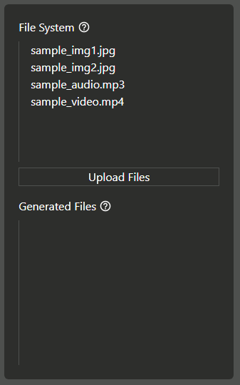

A browser-based terminal to run FFmpeg with WebAssembly.


## Usage

You can run most FFmpeg commands in the web terminal.

Since there is no real filesystem, the terminal uses files from the **File System** panel. Sample media is included by default, and you can upload your own files (nothing is uploaded to a server). Processed outputs appear under **Generated Files**.



## Setup locally

**Requirements:** Node.js 20+ (Node 24 recommended), [pnpm](https://pnpm.io)

```bash
git clone https://github.com/huzaifa-99/ffmpeg-web
cd ffmpeg-web
pnpm install
pnpm dev
```

Open [http://localhost:3000](http://localhost:3000).

## Stack

- Next.js 16 + React 19
- [ffmpeg.wasm](https://github.com/ffmpegwasm/ffmpeg.wasm) 0.12
- xterm.js 6

## Notes

- This project is a hobby / experimental demo of FFmpeg in the browser via WebAssembly.
- FFmpeg core needs `SharedArrayBuffer`, which browsers only enable with these headers:

```
Cross-Origin-Opener-Policy: same-origin
Cross-Origin-Embedder-Policy: require-corp
```

- On first load, FFmpeg core (~25MB) is fetched and cached; later loads are faster.
- For best results, keep files under ~1GB. WebAssembly has a hard ~2GB limit.

## Scripts

```bash
pnpm dev      # development server
pnpm build    # production build
pnpm start    # serve production build
pnpm lint     # eslint
```
